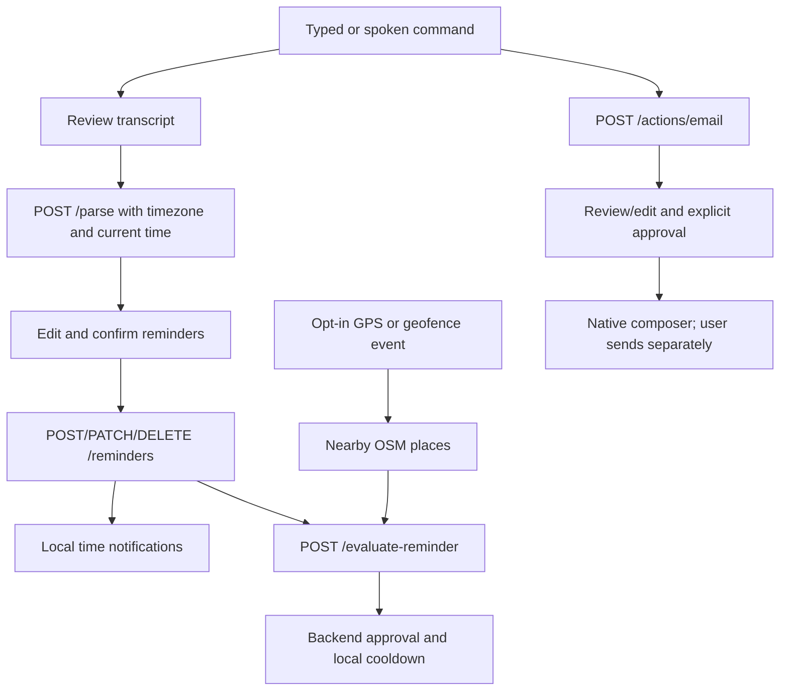

# Person 2 mobile runbook

## 1. What changed and where

This work implements Person 2's side of the two-person plan. The original mobile
implementation was merged to main; the latest backend was pulled at `63ccae6`.
Follow-up fixes are on `person2/reliability-integration`, without backend source edits.
Every implementation commit includes [a work-log entry](person2-work-log.md).
See the [current handoff](person2-reliability-handoff.md) for verification and release gates.

```text
mobile/
  App.tsx                  Navigation, reminder state, lifecycle subscriptions
  src/api/                 Backend requests, persistent mock reminders, actions
  src/components/          Shared controls and speech input
  src/screens/             Home, command, confirmation, detail, location, email, privacy
  src/services/            Notifications, location, places, geofences, sound, mail
  src/types/               Reminder and backend wire contracts
  tests/                   Unit/contract tests and isolated backend integration
  scripts/backend-smoke.mjs Temporary backend harness with automatic shutdown
```

Native service files use `.native.ts`; the regular `.ts` service implements the
browser behavior. Metro selects native files on iOS/Android. All platforms share
the API, validation and screens.

## 2. Install and run the browser

1. Use a Node release compatible with Expo SDK 54 (Node 20.19+); the lockfile records
   reproducible dependency versions.
2. From the repository root, run `cd mobile && npm ci`.
3. Copy `mobile/.env.example` to `mobile/.env` and set the options below.
4. Run `npm run web`. Open the localhost URL printed by Expo.
5. Use Demo mode first: text reminder review/save/list/complete/snooze/delete works
   without any backend. Reminder data survives restarts in AsyncStorage.
6. For browser voice input use a browser implementing SpeechRecognition, with
   microphone permission, on localhost or HTTPS. If unsupported, type the command.

Browser limitations are explicit: native notifications, background location and
geofences require a phone; mail opens via mailto. Browser speech may be handled by
the browser vendor's remote service. No fabricated transcript is returned.

## 3. Configure mock or real backend mode

| Setting | Purpose |
| --- | --- |
| `EXPO_PUBLIC_USE_MOCKS=true` | Persistent demo reminders, sample email draft, held mock context decisions |
| `EXPO_PUBLIC_USE_MOCKS=false` | Calls Person 1's real reminder/action/settings endpoints |
| `EXPO_PUBLIC_API_URL` | Backend address; localhost for browser, computer's LAN IP for a physical phone |
| `EXPO_PUBLIC_API_KEY` | Leave blank for private device tokens. Explicit legacy shared-key mode shares data among holders; bundled values are not secrets |
| `EXPO_PUBLIC_PLACES_URL` | Overpass endpoint; default public OpenStreetMap provider |

1. In `backend/`, run `uv sync` and `uv run uvicorn app.main:app --host 0.0.0.0 --port 8000`.
2. For deterministic backend testing without LLM spend, set `PARSER_MODE=mock` in
   the backend environment. Production model configuration belongs to Person 1.
3. Set the mobile URL and mock flag, then restart Expo so the environment is rebuilt.
4. Leave the mobile shared key blank, including against the hosted backend at
   `https://personal-agent-backend.vercel.app`. The app automatically registers
   `/devices` and sends its Bearer token. Native tokens use encrypted SecureStore;
   browser tokens use tab-session storage. Missing/blocked storage fails explicitly.
   Legacy shared-key mode remains an explicit opt-in for controlled development only.
5. Verify a typed command produces a real saved reminder, survives reload, and is
   visible through `GET /reminders`.

Real API failures are displayed with retry; they never silently switch to fake data.
The backend accepts text only. There is no `/transcribe` upload. Speech is recognized
on the client and the reviewed transcript is sent to `/parse` with time and timezone.

## 4. Native development build

1. Install Xcode (iOS/macOS) or Android Studio plus the matching platform SDK.
2. In `mobile/`, run `npm run ios` or `npm run android` to generate/build the native
   app. For a connected phone use Expo's device selection options as appropriate.
3. Subsequent development sessions use `npm start` for the development client.
4. Rebuild when native dependencies or `app.json` permission plugins change.
5. Use a real device for background and notification checks. Native exports alone
   do not prove native build success; native compilation was not run in this session.
6. SecureStore and react-native-permissions were added in the follow-up: rebuild
   the development client, not just the JavaScript bundle. Confirm your desired
   iOS bundle identifier/Android package before distribution; Expo-generated
   placeholder identifiers from introspection are not distribution configuration.
7. On Android 12+, use Home's explicit exact-time alert action to allow Alarms &
   reminders, then check timing again. Denial retains approximate scheduling and
   shows a warning; it does not prevent use of the rest of the app.

Generated `mobile/ios/` and `mobile/android/` are ignored under Expo continuous
native generation. Plugin config supplies microphone/speech descriptions,
background-location permission/service declarations and notification/mail support.

## 5. Walk through every user flow

### Reminder and voice

1. Home → Add → type or Speak a command.
2. Speaking requires permission and service availability. A tone/haptic response,
   pulsing active indicator and elapsed timer provide feedback. Tap Stop or Discard.
3. Speech ends at 60 seconds, on screen departure or app backgrounding. Review/edit
   recognized text before choosing Review reminder.
4. Confirm title, deadline, trigger and location type. Dates must include an offset;
   category locations keep the category field. Saved places use their saved names.
5. Save waits for the API. The same client ID is used on retry. If parsing finds
   multiple reminders, review each one individually. Cancel leaves unsaved items unsaved.
6. Open Details to complete, snooze for 10/60 minutes or tomorrow at 9 AM, or explicitly
   confirm deletion. Reloading the list reflects successful backend changes.

### Time notifications

1. Home → Enable reminder notifications. Grant the OS request.
2. Create “Remind me in two minutes to call Mom.”
3. A pure time reminder is scheduled at its deadline; snooze uses its replacement
   date. Completion/deletion removes the schedule. Location/combined reminders use
   context evaluation instead of unconditional deadline scheduling.
4. Test the notification Complete and Snooze actions; each updates the real API and
   reconciles local schedules. Denied permission leaves reminder data accessible.

### Location and nearby places

1. Home → Location & saved places. Read the data-sharing explanation and Enable location.
2. Get current location and inspect accuracy; imprecise fixes are rejected.
3. Find nearby places to query Overpass. The list shows names, normalized categories
   and distances with OpenStreetMap attribution. Coverage is not guaranteed; a
   building centroid is not proof the user is inside it.
4. Evaluate nearby reminders to send coordinates/places to `/evaluate-reminder`.
   Backend score/reasons are shown. Notification permission must also be granted.
5. Save the current location as home/school/work or another name, with a 50–1000 m
   radius. Saved places can be loaded and removed.

### Geofences and background context

1. Enable foreground location first. Read the extra explanation, then Enable background.
2. Grant the separate OS permission. A native development build is required.
3. Saved places and coordinate reminders become entry-only regions, limited to 20.
   Adding/deleting places and editing reminders refresh registration.
4. Foreground/background movement updates use balanced accuracy and 200 m thresholds;
   Android interval/deferred updates use 2 minutes. There is no seconds-based GPS loop.
5. Backend-approved context notifications use a persisted 30-minute local cooldown,
   plus `lastNotifiedAt` updates. Completed/snoozed reminders are suppressed.
6. Stop background mode or Disable all location to stop tasks. In-flight callbacks
   recheck consent. Force-quitting/OS power policy can prevent events; no always-on
   delivery guarantee is made. Public places-network failure permits coordinate/
   saved-place evaluation but cannot invent nearby categories.

### Email

1. Home → Draft an email, or speak an email command from Add.
2. Create draft through `/actions/email`; review recipient name, address, subject and body.
3. Fill/verify the recipient address. A name is never treated as an email address.
4. Approve & open Mail saves the edits and approval, then opens the composer/mailto.
   The user decides whether to send inside their mail app. Cancel withdraws the draft.

### Privacy

1. Home → Privacy & permissions → Load backend privacy settings.
2. Inspect actual server retention/storage facts. Disable transcript storage erases
   retained source text via the existing settings endpoint; server limits still apply.
3. Enable storage only when allowed, or select 1/7/30-day limits.
4. Stop location and use device permission settings if desired.
5. History deletion requires explicit in-app confirmation, stops background tasks,
   cancels this app's schedules and deletes reminders/actions/sessions/history.
   Saved places remain. No history deletion was performed against developer data.

The app does not persist raw microphone recordings. Synthesized activation sound
is stored locally in cache. Reminder demo storage is not encrypted. Speech-service
audio handling is separate from backend text storage and is explained in the UI.

## 6. API and data-flow reference



| Mobile operation | Existing backend contract |
| --- | --- |
| Parse | `POST /parse` with text/now/timezone; consumes additional reminders |
| CRUD | `GET /reminders?limit=200&offset=…`, POST/PATCH/DELETE |
| Saved places | GET/PUT/DELETE `/saved-places` |
| Context | POST `/evaluate-reminder` with inline reminder and camelCase context |
| Email | POST `/actions/email`; PATCH action, POST approve/cancel |
| Privacy | GET `/privacy`, GET/PATCH `/settings`, confirmed DELETE `/history` |

## 7. Reproduce verification

```bash
cd mobile
npm ci
npm run typecheck
npm test
npx expo export --platform all
```

For mobile-to-backend smoke tests:

```bash
cd backend
uv sync
cd ../mobile
npm run test:backend
```

The harness creates a temporary SQLite DB and mock-parser backend, waits for health,
runs four real client integration flows, shuts down the server and prints the retained
test DB path. Do not run history tests against your normal backend database.

Existing backend verification (source unchanged):

```bash
cd backend
uv run pytest tests/test_contract.py tests/test_reminders.py tests/test_actions.py tests/test_places.py -q
```

Latest results: 87 mobile tests passed; 5 authenticated isolated integration tests
passed; all 693 offline backend tests passed (2 live tests excluded). TypeScript,
generated native permission configuration and web/iOS/Android exports passed.
Normal unit tests skip the separate integration suite by design. CI now runs the
full offline backend suite, including device/security cases, plus the critical audit gate.

The follow-up review added regression coverage for microphone ownership/cancellation,
deadline/snooze scheduling, delayed context decisions, stale GPS fixes and background
consent cancellation. See [cross-check evidence](person2-cross-check.md) and work-log
steps 11–13. Platform exports do not prove native compilation or physical-device behavior.

Dependency audit after adding the native development client: 0 critical, 23 high,
17 moderate advisories remain in the pinned Expo/RN toolchain. Review these before
public release; blindly forcing the audit's SDK downgrade/major upgrade would break
the existing SDK compatibility. This is not a claim of a clean production audit.

## 8. Person 2 task coverage and physical-device checklist

| Plan day | Implementation | Remaining verification |
| --- | --- | --- |
| 1–2 | Persistent mock/real CRUD, validation, review/edit, complete/delete/snooze | Browser/phone UI smoke test |
| 3 | Real client speech, transcript review and permissions | Microphone, silence, denial and speech-service failure |
| 4 | Timed local notifications and actions | Two-minute delivery, background delivery, complete/snooze |
| 5–6 | GPS, provider taxonomy, nearby list, saved places | Live GPS and real nearby provider results |
| 7 | Error handling and shared contract integration | Complete voice/time/location flows on phone |
| 8–9 | Geofences, opt-in background updates and scoring | Entry events, force-quit and OS power restrictions |
| 10 | Editable email, address verification and composer | Real mail-app open/cancel; user controls send |
| 11 | Manual push-to-talk activation fallback | Activation reliability; always-listening wake word omitted |
| 12 | Privacy, permission states, movement-based updates | Battery baseline versus foreground/background use |
| 13 | Automated tests and this device matrix | Execute matrix on iOS and Android |
| 14 | Accessible controls, demo instructions and architecture | Demo device setup and 60–90-second recording |

For each phone test record device/OS/build, scenario, expected behavior, actual
behavior and pass/fail. Test foreground/background, revoked permissions, offline API,
provider timeout, repeated geofence entry, completed/snoozed state, edited dates,
app restart and history deletion. Verify no duplicate notification within cooldown.

Battery measurement: record starting battery %, elapsed time and ending % for a
30-minute idle baseline, foreground movement and opted-in background movement;
use comparable screen/network conditions. This measurement was not performed here.
Use the [device validation record](person2-device-validation.md) to capture actual
device/OS/build, results and battery measurements; all entries start as not run.

Quiet-hours behavior: a positive context match held by backend `quietUntil` becomes
a persisted local notification for that time. The alert explicitly says it was held;
it is not a fresh location assessment. Completion, deletion, edits, snooze and location
opt-out cancel stale held schedules once processed locally. Browser notification
delivery is unsupported. OS delivery still needs device verification.

## 9. Demo walkthrough (60–90 seconds)

1. 0–15 s: Speak “Remind me to buy milk when I'm at a grocery store today.” Review
   transcript and save the reminder.
2. 15–35 s: On the prepared demo device, visit a real nearby grocery or use documented
   simulator GPS controls. Display the provider/evaluation result and notification.
3. 35–55 s: Speak “Write an email to Alex saying I'm running ten minutes late.” Enter
   a verified test address, edit the draft and open Mail; cancel rather than send.
4. 55–75 s: Show the data-flow diagram and Privacy screen. Explain microphone access
   only on demand and optional background location.
5. 75–90 s: Show complete/snooze and the location stop control. Capture the device
   screen after the manual matrix passes; no demo video has been recorded yet.

## 10. Sources

- [Expo SDK 54 location](https://docs.expo.dev/versions/v54.0.0/sdk/location/)
- [Expo SDK 54 notifications](https://docs.expo.dev/versions/v54.0.0/sdk/notifications/)
- [Speech recognition module and SDK tags](https://github.com/jamsch/expo-speech-recognition)
- [Overpass QL query language](https://wiki.openstreetmap.org/wiki/Overpass_API/Overpass_QL)
